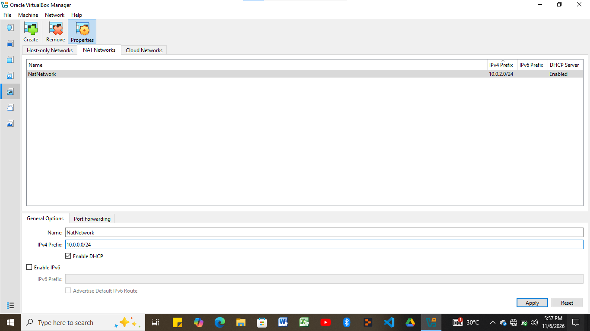
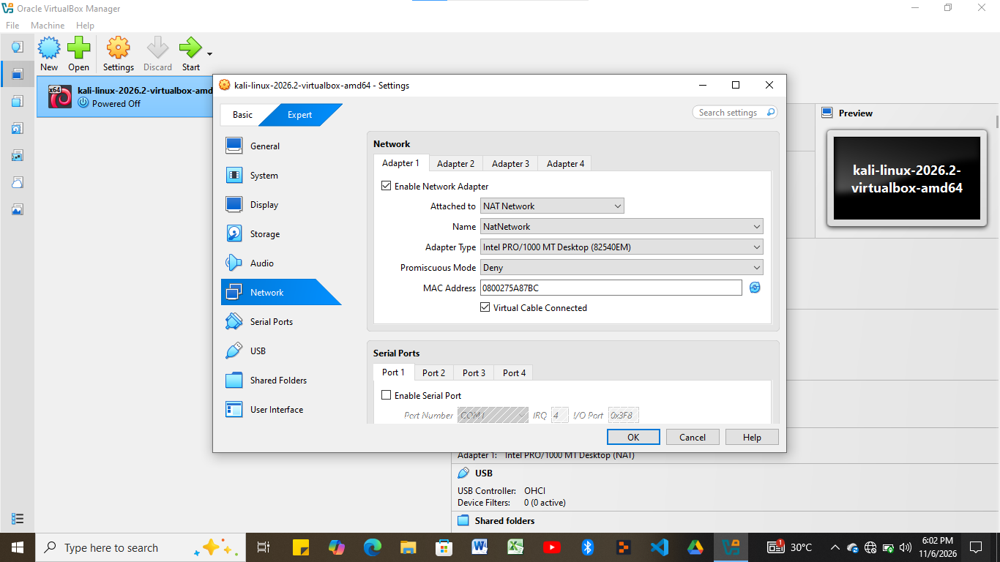

# Kali Linux VirtualBox Lab — Network & Static IP Configuration

## Overview
This repository documents the setup and network configuration of my **Kali Linux (`kali-linux-2026.2-virtualbox-amd64`)** virtual environment inside Oracle VirtualBox. The objective of this lab was to create a custom isolated NAT Network (`10.0.0.0/24`), attach the Kali VM to the subnet, and manually configure a static IPv4 address (`10.0.0.2`) with verified gateway routing and external DNS resolution.

---

## Network Specifications

| Parameter | Configuration |
| :--- | :--- |
| **Hypervisor** | Oracle VirtualBox |
| **Virtual Machine** | `kali-linux-2026.2-virtualbox-amd64` |
| **Network Mode** | NAT Network (`NatNetwork`) |
| **Subnet Prefix** | `10.0.0.0/24` |
| **Interface** | `eth0` (`08:00:27:5a:87:bc`) |
| **Static IP Address** | `10.0.0.2/24` |
| **Default Gateway** | `10.0.0.1` |
| **DNS Server** | `8.8.8.8` |

---

## Step-by-Step Configuration & Verification

### 1. Creating the Custom NAT Network
Inside the **Oracle VirtualBox Network Manager**, I configured a custom NAT Network named `NatNetwork` and updated the IPv4 Prefix to `10.0.0.0/24` with DHCP enabled to support internal lab routing.



### 2. Attaching the Kali VM Network Adapter
In the virtual machine settings under the **Network** tab, I enabled **Adapter 1**, attached it to **NAT Network** (`NatNetwork`), and verified that the virtual cable was connected using the Intel PRO/1000 MT Desktop adapter (`0800275A87BC`).



### 3. Booting the Kali Linux Environment
With the hardware and network adapter settings applied, I booted into the Kali Linux desktop environment to configure the guest OS network stack and host integration features.


### 4. Static IP Assignment & Connectivity Verification
Inside the Kali terminal, I configured `Wired connection 1` (`eth0`) with a static IP of `10.0.0.2/24`, gateway `10.0.0.1`, and DNS server `8.8.8.8`. 

**Troubleshooting Note:** Because VirtualBox's internal NAT engine normally reserves `.2` for internal DHCP services, standard `NetworkManager` Duplicate Address Detection (DAD) initially blocked the interface from coming up (`IP configuration could not be reserved`). To resolve this conflict, I cleared `/etc/network/interfaces` to prevent service clashes and set `ipv4.dad-timeout 0` via `nmcli`:

```bash
sudo nmcli connection modify "Wired connection 1" ipv4.dad-timeout 0
sudo nmcli connection up "Wired connection 1"# Lab-Set-up-Networkwalks-Internship
Lab set-up Configuration for Networkwalks Internship
